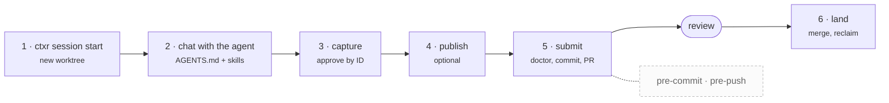

# Contexture (`ctxr`)

[](https://www.npmjs.com/package/ctxr-cli) [](https://github.com/ayxuerui/contexture/actions/workflows/ci.yml) [](LICENSE)

**Your agents' long-term knowledge — they write it, you review it before it lands.**

Contexture turns a git repository into shared, durable knowledge, and ships the operating procedures an AI agent needs to work it: what to do with a new source, where a note belongs, when a synthesis has gone stale, how a change gets reviewed and landed. Every write lands the way code does — in a branch, past a health check, through a pull request you approve.

This is one layer of agent memory — the shared one. Your harness keeps what an agent knows about you and itself; contexture keeps what *you* know, reviewed and versioned, outliving any single agent or session. Claude Code, Codex, Cursor, Cline, Gemini CLI, a cron job, or you at a terminal all operate the same store through the same files.

A **store** is an ordinary git repository: markdown notes joined by `[[wikilinks]]`, with `contexture.yaml` as the single source of truth for how that particular store is shaped — its taxonomy and its paths. `ctxr` is a mechanism-only CLI over it — it builds indexes, enforces invariants, and performs validated writes, but it makes no editorial decisions. The judgment lives in **skills**: portable markdown decision procedures that `ctxr init` installs into the store, which whatever agent you're talking to reads and follows. That split is the whole design, and it's what makes the same store operable from any harness.

## Install

```sh
npm install -g ctxr-cli
```

Requires Node 26 or newer.

The package is `ctxr-cli`, the command it installs is `ctxr`, and the project is Contexture — which is why a store’s own files keep the full name (`contexture.yaml`, `.contexture/`, `CONTEXTURE_*`). A `contexture` alias executable is installed too; docs and generated files always say `ctxr`.

Running an agent harness in a container? [contexture-images](https://github.com/ayxuerui/contexture-images) publishes harness runtimes with `ctxr` already installed — currently `ghcr.io/ayxuerui/contexture-hermes`, tagged by the `ctxr` version it carries. Nothing here depends on it; `ctxr` itself is distributed only through npm.

## Quickstart

```sh
mkdir my-store && cd my-store
ctxr init
```

`ctxr init` asks two questions, then creates the git repository (if there isn't one), scaffolds the store, and commits it:

- **Which taxonomy profile?** `para` (Projects / Areas / Resources / Archives — the default), `zettelkasten` (no layers at all; structure emerges from links), or `diataxis` (Tutorials / How-to / Reference / Explanation). Or bring your own layer list with `--taxonomy <file.yaml>`.
- **Which agent harnesses?** Any of:
  - `claude-code` (the default). Its adapter generates `CLAUDE.md`, a one-line import of `AGENTS.md`.
  - `hermes-agent`, `codex`, and `antigravity`. These read `AGENTS.md` directly, so they need no entry file at all. Codex and Antigravity also read `.agents/skills/` natively. See [Codex and Antigravity](#codex-and-antigravity).
  - `--harness none` opts out.

Non-interactively, pass them as flags — nothing ever blocks on a prompt:

```sh
ctxr init --profile para --harness claude-code
```

`init` is idempotent. Re-running it against an existing store reconciles it instead (the same code path as `ctxr update`) rather than overwriting anything.

## What a store looks like on disk

After `ctxr init --profile para`:

```
contexture.yaml               single source of truth — what this store chose; the rest takes shipped defaults
AGENTS.md                     generated entry document — managed sections, held to a size budget
CLAUDE.md                     harness entry file; a one-line managed import of AGENTS.md
.claude/
  skills/ -> ../.agents/skills   a bridge, so Claude Code auto-discovers the canonical skills
.agents/skills/               THE canonical skills location, read natively by most harnesses
  ctxr-*/SKILL.md               17 contexture-owned skills (refreshed by `ctxr update`)
  frontend-design/, eli5/       vendored third-party skills, with licenses and provenance
.contexture/guidance/
  house-conventions.md        your store's own rules — inlined into AGENTS.md verbatim
  <topic>.md                  rules for one task — declare `read_when`, and AGENTS.md routes to them
  mission.md                  the standing "what's active right now" document
.contexture/templates/
  Note.md                     the base every note shares — copy it to cut your own kind
  Concept.md Project.md       the shapes a note starts from (refreshed by `ctxr update`)
  People.md Company.md Deal.md
  .ctxr-templates.json        which of these contexture delivered, and their hashes
.githooks/
  pre-commit                  runs `doctor --staged`
  pre-push                    refuses a push to the default branch
projects/ areas/ resources/ archives/     the taxonomy's layers
raw/inbox/                    where captured material lands, before ingest
```

These appear the first time they're needed rather than at init:

```
raw/<YYYYMM>/                 retained captures, one directory per month of ingest
.contexture/catalog/*.md      one section per layer, plus uncategorized — tracked in git
.contexture/publish/          published pages
.contexture/cache/            gitignored — graph.json and the human-readable graph.md
.worktrees/                   gitignored — session worktrees
```

Two distinctions make the rest of this readable:

**Derived vs. authored.** Never hand-edit inside a `contexture:<region>` fence — the next build overwrites it. Edits *outside* a fence survive every rebuild, and that's where they belong: the catalog generates each note's entry line but preserves the one-line gloss you write next to it, forever.

**`.contexture/` is not content, and neither is `raw/`.** The store's own home directory, the skills directory, and the worktrees path are excluded from every retrieval leg by default (`retrieval.exclude_paths`), so the store's plumbing never shows up as an answer to a question about the store's subject matter. `raw/` — the capture tier — is excluded for a different reason: what arrived is not yet what you know. It is tracked in git all the same, because a retained capture is the provenance behind a note.

## How agents drive it

`ctxr init` writes two things an agent reads, both generated from your store's own config — never from a hardcoded layout:

**`AGENTS.md`**, with these managed sections:
- *Store fundamentals*: root resolution, the frontmatter schema, the write path.
- *Mission*.
- *Retrieval*.
- *Capturing and ingesting*.
- *Placing a new note*, rendered from your actual taxonomy layers.
- *Store conventions*.
- *Read when*, when any guidance loads on demand.

Every harness loads this file on every turn, so it is kept short. contexture's own share is held under a ceiling by a test, and procedure a skill already carries lives in that skill.

**The skills**, installed as full copies at `.agents/skills/ctxr-<name>/SKILL.md`. That path is the cross-harness canonical location; a harness that reads its own branded directory instead gets that directory bridged to it (`.claude/skills/` is a symlink), so skill auto-discovery works with no wrapper and no second copy. A harness without auto-discovery reaches the same file by path from `AGENTS.md`. They're contexture-owned — refreshed by `ctxr update`, never hand-edited — and they're written against *your* store's configured taxonomy, so no shipped profile's layer names leak into them. Your own skills live alongside, untouched by sync. An owned skill may carry files beside its `SKILL.md` — `ctxr-second-opinion` ships the script that runs its reviewers — and update keeps that whole directory matching the package.

| Skill | What it decides |
| --- | --- |
| `ctxr-capture` | What the record of a source actually is, and where capture stops |
| `ctxr-ingest-orchestration` | What the store should know after a source — not where to file it |
| `ctxr-placement` | Which layer and location a note belongs in, and why |
| `ctxr-connection-finding` | Traversing links that already exist |
| `ctxr-connection-proposal` | Discovering links a note *should* have |
| `ctxr-rollup` | Synthesizing an entity's current state from every note referencing it |
| `ctxr-mission` | Keeping the store's priorities / back burner / debt document current |
| `ctxr-organize-audit` | Placement review, retiring, classifying broken links |
| `ctxr-derived-artifacts` | Rebuilding catalog, graph, and generated docs without clobbering them |
| `ctxr-publish` | Whether a subject earns a page, and what may appear on it |
| `ctxr-session-lifecycle` | Starting a session, re-scanning, conflicts, sequencing several PRs |
| `ctxr-submit` | Everything up to and including opening the pull request |
| `ctxr-land` | Merging after review, and reclaiming the worktree |
| `ctxr-session-capture` | What a finished session produced that is worth keeping |
| `ctxr-upgrade` | Whether to upgrade the installed CLI now, and asking before it does |
| `ctxr-second-opinion` | Whether a plan or a taste call needs three different model families, and how to weigh what they say |
| `ctxr-research` | How to research a question against real sources — a brief and findings ledger, perspectives, source tiers, contradictions, and every claim verified against a source it opened — with whatever web access the harness has |

One more skill is opt-in. A store gets `ctxr-capture-circleback` only when its `contexture.yaml` declares a `circleback` block, and loses it at the next `ctxr update` once the block is gone:

| Skill | What it decides |
| --- | --- |
| `ctxr-capture-circleback` | `ctxr-capture`'s retrieval step for Circleback: which meetings this store owes, by tag, when one Circleback account feeds several stores. It writes each into the inbox as the verbatim record and hands back to `ctxr-capture` at step 2 |

```yaml
circleback:
  tag: pkm               # meetings tagged this belong to this store
  other_tags: [readyrun] # meetings tagged any of these belong to another store
  # decline_tag: no-capture   (the default) marks a meeting no store captures
```

`ctxr-capture` reaches it by its family name: when a store ships a `ctxr-capture-<source>` skill for the material's source, capture retrieves through it and continues from its own step 2. The runner, `sweep.mjs`, drives Circleback's own CLI (`cb`, signed in separately), plus `git` and `gh`, and never handles a credential. Run it from the store root with `node .agents/skills/ctxr-capture-circleback/sweep.mjs`, or point a scheduled job at it; the skill says what to do with its report.

Your house rules go in `.contexture/guidance/`.

**A file there is inlined into `AGENTS.md`'s *Store conventions* section in full**, so it loads for every harness at the start of every session. That's right for the rules that hold on every turn.

**A rule that matters only for one task belongs in its own file, with a trigger in its frontmatter:**

```markdown
---
title: Research style
read_when: Before a research pass or recording evidence
---
```

That file is not inlined. `AGENTS.md`'s *Read when* section lists it as one line: its trigger and its path.

**Size limits:**
- `ctxr lint` reports when `AGENTS.md` grows past `harness.entry_document_target_bytes`, which is 20 KiB by default.
- `ctxr doctor` fails when it grows past `harness.entry_document_max_bytes`. The default is 24,000 bytes, the smallest limit any supported harness reads in full, so a store works in Claude Code, Codex, and Antigravity whichever it declares.

## Codex and Antigravity

Both read `AGENTS.md` at the store root and discover skills under `.agents/skills/` natively. A store targeting them needs no entry file and no bridged directory. Two things differ from Claude Code.

**They stop reading `AGENTS.md` at a fixed size, silently.**

| Harness | Stops reading at | Measured on | Can it be raised? |
|---|---:|---|---|
| Codex | 32,768 bytes | codex-cli 0.154.0 | Yes: set `project_doc_max_bytes` in your own `~/.codex/config.toml`. A repo-level `.codex/config.toml` is not honored for it. |
| Antigravity | about 24,000 bytes | agy 1.3.2 | No. |

- **Codex's limit covers every `AGENTS.md` it loads, combined**, from the repo root down to your working directory, so nested ones spend the same budget.
- **Every store is held to the smaller of the two, 24,000 bytes, by default**, whether or not it declares these harnesses. `ctxr doctor` fails past it, naming each harness that would cut the file off and the section where it stops. The remedy is to move task-specific guidance behind `read_when`, or trim the mission. A store that really runs only where nothing is cut off can raise `harness.entry_document_max_bytes`, which records that choice in its configuration.

**Codex's sandbox keeps `.git` read-only.** Interactive Codex asks you to approve each git step of `ctxr-submit` outside its sandbox: `git add`, `git commit`, `git push`, `gh`. That includes session worktrees, whose git data lives in the main repository's `.git/worktrees/`.

## A session, end to end

This is the loop you actually live in: start a session, talk to the agent, publish, submit, land.




**1. Start.** `ctxr session start` creates a git worktree on a generated `session/…` branch off a freshly fetched `origin/<default-branch>`, and prints its path:

```
Session worktree at "/path/to/my-store/.worktrees/session-20260903-060120-5ccbd6"
on branch "session/20260903-060120-5ccbd6" (from master).
```

With no remote configured it falls back honestly to the local branch tip rather than failing. `cd` there and open your agent. Never work in the canonical clone — `ctxr session list` shows what's active. (The default branch is whatever `git init` actually created, recorded once at init; nothing hardcodes `main`.)

**2. Chat.** Your harness loads `AGENTS.md` — or `CLAUDE.md`, which imports it — at session start, and discovers the skills through the bridged directory. Describe what you want in plain language: *"read this article and file it"*, *"what do we know about Acme"*, *"roll up this entity"*, *"make me a page comparing these three"*. The agent picks the skill. There's nothing to memorize; the [knowledge loop](#the-knowledge-loop) below is what it runs on your behalf, documented for when you want to drive a step yourself.

**3. Wrap.** On *your* closing signal — "done", "ship it", a sign-off; never the agent's own summary — `ctxr-session-capture` fires exactly once. It proposes, in a single message with IDs, what the session produced that is durable, split by kind: a **fact** about what happened becomes a store note, a **rule for future work** becomes a house convention. Nothing is written until you approve by ID. Approved notes go through:

```sh
ctxr session capture --proposal approved.yaml
```

```yaml
notes:
  - id: A1
    path: resources/Acme.md
    mode: create          # or: append
    frontmatter:
      title: Acme
    body: |
      # Acme
```

Each item is validated and applied independently, so one bad path refuses that item alone rather than the whole proposal. Approved *conventions* aren't notes — they're a direct edit to `house-conventions.md` followed by `ctxr update`, staged in the same commit. (A guidance edit without the matching `AGENTS.md` regeneration fails `doctor --staged`, and the pre-commit hook refuses it.)

**4. Publish**, if the session earned a page. Run it before submit so the page rides the same pull request. See [Express](#5-express--publish-a-page) below.

**5. Submit.** `ctxr-submit`: re-scan git state (never replay a plan from an earlier snapshot), run the capture pass, stage surgically with `git add <paths>` — never `-A`, and derived cache paths never stage — then `ctxr doctor` over the whole store, not `--staged`: a session's job is to leave the *store* healthy, not merely to pass one commit's gate. Then commit, rename the generated branch to something meaningful before it reaches the forge, `git push -u origin <branch>`, and `gh pr create`. If `gh` has no reachable GitHub remote, the push still succeeds on its own and you get manual pull-request instructions instead of a retry loop.

**6. Land.** `ctxr-land`, after review: name the pull request explicitly rather than inferring it from whichever checkout you're standing in, read its state with `gh pr view` (and its decision with `ctxr review list`, when the store [approves changes from a page](#approving-changes-from-a-page)), then wait for an explicit go — plan consent is not fire consent — unless a decider already approved it on the page. Then `ctxr land <pr>` (with `--confirm` when the consent is your go): it catches the branch up with the default branch, merges, re-reads the forge to confirm the merge rather than trusting an exit code, fast-forwards the canonical clone, and removes the worktree and its branch — nothing sweeps up afterward, so a worktree left here is left indefinitely.

`ctxr-session-lifecycle` covers what surrounds both halves: when to re-scan, the conflict playbook, and sequencing several pull requests.

### Why step 5 isn't a CLI command, and step 6 is

Submitting is ordinary `git` and `gh`. The CLI owns only what git cannot do — creating the worktree, applying validated note writes, running the health gates — and the sequencing, the confirmation gates, and the judgment live in the skills, where you can read and change them. That's why `ctxr session` has exactly three subcommands: `start`, `capture`, and `list`.

Landing was the same until a person could approve a change from a page. Then the thing that acts on an approval has no agent in it, and its one job — merge only a head someone approved — is a check that has to be enforced, not an instruction an agent follows. So `ctxr land` is code: it never resolves content, and the decision of *when* to land stays in `ctxr-land` and on the approval page.

Two mechanical backstops hold the line underneath all of it: the **pre-commit** hook runs `doctor --staged`, and the **pre-push** hook refuses a push to the default branch (`CONTEXTURE_ALLOW_DEFAULT_BRANCH_PUSH=1` is the emergency override, for emergencies). Both are version-controlled git hooks, so they hold whichever harness, or human, does the writing.

## The knowledge loop

What the agent is doing inside step 2 — and how to drive any of it by hand.

Four of these are the moves knowledge work is made of: **capture** what arrives, **organize** it so it stays navigable, **distill** it into something that answers a question, **express** it for a reader who wasn't there. Retrieval isn't a stage — it's what makes the other four worth doing — but it sits second here because it's the one you reach for constantly.

### 1. Capture — get material in without duplicating it

Capture is writing the material into `raw/inbox/`; no CLI wraps it, and contexture fetches nothing — the transport is whatever your harness has connected, which is what keeps a vendor's release cadence off this tool's. What contexture owns is the shape: a capture may already carry `source_type` and `source_id` — whatever fetched it usually knows them — but never `source_hash` or `ingested`, which contexture assigns once, at ingest. Then:

```sh
ctxr source check raw/inbox/note.md --source-id https://example.com/a
# ...read the cluster, decide, write or extend the note...
ctxr ingest raw/inbox/note.md --into resources/topic.md --source-type article --source-id https://example.com/a
```

`source check` returns one of five verdicts: `new`, `already_ingested`, `drift` (same source, its content moved — read what changed before deciding), `alternate_source_match` (this content is already here under a different identity), or `multiple_matches` — which exits non-zero and means *stop and resolve the ambiguity yourself*, never guess which existing record it is. URLs are canonicalized first, with tracking parameters stripped (`ingest.tracking_params`). `ctxr source stamp` backfills a record with no hash on file; `ctxr source add-alt` records material re-published at a new URL, rather than ingesting it twice.

`ctxr ingest` stamps the four identity fields **onto the capture**, moves it out of the inbox into `raw/<YYYYMM>/`, records its path in the destination note's `sources` list, and rebuilds the catalog. The note carries no source identity of its own, which is what lets it be rewritten, merged or restructured without invalidating the frozen hash — and what lets one note cite the several captures it was built from. `--into` is required: ingest never creates the note, because deciding what the store should know is the work.

Material that isn't markdown can't carry frontmatter, so it travels with a markdown sidecar naming it in `capture_file`; the hash is taken over that file's bytes and the two move together.

A capture stands as provenance only if it carries the record it rests on, and a service's own summary is its *derivation* of that record, not the record. `ingest.required_capture_sections` maps a source type to the section a capture of that type must contain — `ctxr ingest` refuses one that doesn't (exit 3, nothing written), and `ctxr lint` reports it while it waits in the inbox. Undeclared by default, and a source type with no entry is unconstrained; the store names its own source types, because contexture knows none of them.

`ctxr-capture` carries the procedure that produces such a capture — finding the material among whatever sources are connected, writing the record as the source supplied it rather than a reading of it, and stopping at the inbox. It matters most when material reaches the store through an agent rather than a script, which is why the section rule above is a check and not only an instruction.

The commands are the easy part. `ctxr-ingest-orchestration` exists because ingest is **synthesis, not filing** — "create a new note" is one option among several, and the skill's decision table (new note / expand an existing one / merge two / restructure / add a section to a hub) is the actual work. Every row of that table ends in the same `ingest` call, so provenance is recorded whichever one you take. `ctxr-placement` decides where the result lives, and says why.

### 2. Retrieve — three legs, no ranker

```sh
ctxr catalog show --section projects      # curated index, one section per layer
ctxr graph build                          # then query it, or read .contexture/cache/graph.md
ctxr graph query neighbors <path> --depth 2
ctxr graph query hubs
ctxr graph query orphans
```

The **catalog** is coverage-guaranteed: every retrievable note has exactly one section, so nothing is silently unindexed. Section ids are your layer paths plus `uncategorized` (or a single `notes` section under a zero-layer profile). The **graph** enumerates structure and ranks nothing — neighbors, shortest path, hubs, clusters, bridges, orphans; `--type <relation>` follows one relation. The vocabulary is fixed, not configurable: a link under `## Upstream` (what this note is built on), `## Downstream` (what follows from it), `## Similar` (what it resembles, where neither depends on the other), or `## Opposing` (what contradicts it) becomes an edge of that type. Edges are directed — naming a note Upstream does not write the reciprocal Downstream edge on it — and a heading outside the four yields an ordinary untyped link. `graph build` also writes a human-readable `graph.md` summarizing hubs by cluster. The third leg is **your own grep**, for literal strings the first two can't answer, scoped to exclude `.contexture/`.

There is no `ctxr search`, and no semantic ranking. That's deliberate, not missing.

→ `ctxr-connection-finding` (traverse what exists), `ctxr-connection-proposal` (discover what should).

### 3. Organize — keep it navigable as it grows

```sh
ctxr lint          # observations — orphans, broken links, material still in the inbox; always exits 0
ctxr doctor        # invariants — exits non-zero, and gates every commit
ctxr catalog check --stale
ctxr archive <path>
```

A new note starts from a template under `templates.path` (`.contexture/templates/` by default), never from a blank file and never by copying whichever sibling is nearest — that's how a store's notes drift out of any shape at all. `templates.installed` says which of the packaged library a store wants, defaulting to all of it and meaning "install none" when empty, exactly like `skills.vendored`; your own kinds sit in the same directory and are never touched, since contexture only owns the names it packages. A shipped template is contexture's: edit one and `ctxr update` puts it back. A house variant lives under a name the packaged set doesn't use, which nothing touches. A template is fixed content — the same bytes in every store — so the idea template carries the four relation sections literally, each with a note on what belongs under it, plus a `## Source` section for the prose account of where an idea came from (distinct from the `sources:` frontmatter `ctxr ingest` writes). `{{title}}` and `{{date}}` are the whole placeholder vocabulary; the agent substitutes them as it writes, no command expands them, and `ctxr lint` reports a note that landed with one still in it. An existing note is extended in place, never re-cut from a template.

The `lint` / `doctor` split is the point: lint reports what's *worth reviewing* and never blocks; doctor reports what's *broken* and does. `ctxr archive` retires a note — or a folder of notes whole — as a single tracked rename to the same path beneath `organize.archive_destination` (`projects/Bet` → `archives/projects/Bet`), leaving every note byte-identical and reporting every note that linked to it — move it, don't tag it, or the active layers stop meaning anything. (The note must be committed first; archive won't rename something git isn't tracking.)

→ `ctxr-organize-audit`, `ctxr-derived-artifacts`.

### 4. Distill — rollups and the mission document

```sh
ctxr rollup stale                                   # entities whose backlinks moved since last synthesis
ctxr rollup gather <entity>                         # enumerate the source notes
ctxr rollup write <entity> --content-file draft.md  # idempotent fenced write
```

Gather and write are deterministic; the synthesis in between is the agent's, over *every* source rather than a sample. The write only ever touches the fenced region — hand-written content elsewhere in the note is never disturbed, and re-writing identical content reports `changed: false` and leaves the file byte-identical.

The store's own `.contexture/guidance/mission.md` uses the same write path, but is reported stale on elapsed time (`organize.rollup_stale_days`) rather than on backlinks.

→ `ctxr-rollup`, `ctxr-mission`.

### 5. Express — publish a page

```sh
ctxr publish gather --note <path>          # or --under <prefix>, or --entity <name>
                                           # -> "Page filing: <derived path>/<page-name>"
ctxr publish new <derived path>/comparison # scaffolds the page folder and its sibling README
ctxr publish stamp .contexture/publish/<derived path>/comparison   # records the hash of the note the README leads with
ctxr publish check .contexture/publish/<derived path>/comparison/index.html

ctxr publish new --disposable agent-week   # -> .contexture/publish/disposable/<today>-agent-week
```

A page has one of two lifespans, read from where it is filed. A **permanent** page is the rendered form of one note that keeps changing: its README leads with a wikilink to that note (a folder's hub note, for a page drawn from a folder), `ctxr publish stamp` records the note's hash beside the link, and `check` fails the page — and `ctxr lint` lists it — once the note changes, until somebody reviews the page, removes the marker and stamps again. A **disposable** page is built to understand something once; it lives under `disposable/<YYYY-MM-DD>-<name>`, dated by the command, is never revised after it lands, and `ctxr lint` lists it as a removal candidate after 30 days — removal is the operator's call, made through a reviewed pull request.

`gather` resolves a subject to its note set — never a hand-picked list, which is how an unintended note slips onto a page unnoticed — and derives where the page belongs from where the subject's own notes live, at whatever depth the store carries them to. So the published-pages navigation reads like the store rather than like one long list, and a subject's second page collects beside its first under one folder naming the subject; `gather` reports the page that move would displace, and moves nothing. `check` runs the structural gates: no external references, viewport meta, a print rule, provenance, the sibling README, script syntax, that the page is not filed flat at the publish root, and — by lifespan — a disposable page's dated shape or a permanent page's represented note and its recorded hash. Both `new` and `check` end by naming the address `ctxr serve` answers for the page — the preview route while the page is still in a session worktree, together with the published-pages address it takes once that work lands, so the page gets looked at while changing it is still cheap. What a page may *contain*, given who will read it, is a judgment `ctxr-publish` walks you through and no check can make.

→ `ctxr-publish`, plus the vendored `frontend-design` and `eli5` skills for the craft contexture supplies none of.

## Reading a store in a browser

```sh
ctxr serve
```

Renders notes, catalog sections, the graph document, and published pages as cross-linked HTML. It binds loopback (`127.0.0.1`) by default. `--host` widens that, but note what it does not change: `serve` applies **no per-requester filtering at any bind address**. Widening it exposes the whole store to whatever can reach that address, so only do it behind a front end you've arranged yourself. The one exception is the approval page below, which verifies who is asking before it shows or records anything.

A published page's navigation label follows its own declared `<title>`, falling back to its folder name when it declares none. A folder group is labelled with the declared name of the taxonomy layer whose path it matches — so a store's own words for its top-level folders reach the sidebar — and with the bare directory name otherwise; either way a group sits where its directory name sorts, not where its label does. The header's light/dark/system links choose a display theme, and the ☰ control shows and hides the navigation — both persist across pages via cookies, and neither requires client-side script. A published page itself is still served byte-verbatim, so neither the theme nor the navigation reaches into it; `ctxr publish new`'s scaffold instead follows the viewer's own system preference on its own.

The **Preview** area, directly below the published pages, holds the pages your open session worktrees are carrying. A page is previewable from the moment its files exist on disk — before any commit, before any push, before a PR is opened or merged — because `serve` reads the worktree rather than asking git or a forge anything. Pages group by the worktree holding them at `/preview/<worktree>/<page>/index.html`, and a preview is byte-identical to what `/publish/<page>/index.html` will serve once the page lands, so what you read is what ships. Both routes address files rather than directories, so a page's address always names its index file — which is the address `ctxr publish new` and `ctxr publish check` report, so you never have to work out which of the two applies. For a whole change set, `ctxr publish urls --staged` (or `--since <ref>`) reports every page added, modified, moved or removed with both addresses, which is what `ctxr-submit` puts in a pull request's **Pages** section; set `serve.previews: none` in `contexture.yaml` if previews never resolve for your reviewers. A session worktree carrying no page appears nowhere, and nothing else inside one — notes, catalog, graph, config — becomes reachable.

## Approving changes from a page

People who own a store's content often have no forge account. With change approval declared, `ctxr serve` gives them a page instead: `/approve/` lists every session with an open pull request, and each one's page shows the author's account of the change (its title, description and commit messages, labelled as the author's), the knowledge changes computed from the commits, the preview of every changed page, and every changed line. Two buttons — **Approve** and **Request changes** — record the decision on the pull request, as a review by the store's own forge identity naming the person who decided and the commit they saw. Nobody needs a GitHub account to leave an entry in the audit trail.

```yaml
serve:
  base_url: https://ctx.example.com
change_approval:
  identity:                       # the signed assertion your access proxy forwards
    header: Cf-Access-Jwt-Assertion
    issuer: https://<team>.cloudflareaccess.com
    audience: <application aud tag>
    jwks_url: https://<team>.cloudflareaccess.com/cdn-cgi/access/certs
  deciders: ["@example.com"]      # exact emails or @domain entries
  recording_login: ctx-approvals  # the forge identity decisions are recorded as
  resolver: ["claude", "-p"]      # optional: who resolves a conflict
```

Identity comes from the proxy in front of `serve` (Cloudflare Access, Google IAP, oauth2-proxy): every `/approve/` request must carry its signed assertion, verified against the key set, issuer, audience and expiry, or it gets `401`. A request that reaches the port around the proxy carries none.

Then the system does the rest, inside `ctxr serve` itself — no scheduler. Right after an Approve, and every five minutes as a sweep (once ten seconds after startup, for approvals made while it was down), `serve` runs `ctxr land --pending` as a child process. That lands every pull request whose current head carries an approval — rebasing it onto the default branch when it is behind, merging, syncing the canonical clone, and removing the worktree. A clean rebase keeps the approval only when every commit's patch is unchanged, and the carry-over is recorded on the pull request. A rebase that conflicts goes to the configured resolver; its result is checked (clean, rebased, `ctxr doctor` passes), pushed, and handed back to the page for a new decision, because nobody has read an agent's merge of two sides. With no resolver, the change is marked blocked. Requested changes and blocked landings reach the next agent session through `ctxr review list`.

Runs never overlap, and only one landing runs per repository at a time: `ctxr land` holds a lock in the repository's git directory, so `serve`, a second `serve` and a person running `ctxr land` by hand never race. A run's output goes to `serve`'s stderr, prefixed `land:`, and a failed run never affects a page. On a host with no git identity, the catch-up rebase commits as the recording login. Every run also brings the store's canonical clone up to date: it fast-forwards to the default branch when the clone is on that branch, has no uncommitted changes to tracked files, and has not diverged, so anything merged on the forge (a configuration change, notes, pages) is served within one sweep. Otherwise the clone is left exactly as it was, and the run reports why as a warning (`canonical_sync` in `ctxr land --pending --json`). `serve` needs write access to the store for this. Set `change_approval.land: manual` to turn it off, for a deployment that runs `ctxr land --pending` some other way; `ctxr land` stays available for landing by hand.

Outside the store, set up the recording identity (below) and, where your plan allows it, a branch protection rule requiring one approving review.

### Recording identity

Decisions and landings are recorded on the pull request by one forge identity, the `recording_login`. It must not be the identity your agents open pull requests with: the forge refuses an approval from a pull request's own author. There are two ways to provide it.

**A GitHub App (recommended).** No account to look after, no seat, and no token to rotate: the App's private key does not expire, and contexture mints a one-hour installation token from it whenever it needs one.

1. Create the App at <https://github.com/settings/apps/new> (or the organization's equivalent). Leave the webhook inactive and the callback URL empty, and request no user authorization. Under **Repository permissions** set **Contents**, **Issues** and **Pull requests** to *Read and write*; **Metadata** is read-only by default. Nothing else. [`templates/approve/github-app-manifest.json`](templates/approve/github-app-manifest.json) holds the same settings for GitHub's manifest flow.
2. Generate a private key on the App's page, and keep the `.pem` outside every repository, readable only by the user that runs `serve` (`chmod 600`).
3. Install the App on the store's repository, selecting only that repository.
4. Set `recording_login` to the App's slug followed by `[bot]`, e.g. `ctx-a-approvals[bot]`.
5. Give `ctxr serve` these, and nothing else needs a forge credential:

```sh
CONTEXTURE_GITHUB_APP_ID=<the App ID>             # or its client ID
CONTEXTURE_GITHUB_APP_PRIVATE_KEY_FILE=/run/secrets/ctx-approvals.pem   # or CONTEXTURE_GITHUB_APP_PRIVATE_KEY=<the PEM text>
```

contexture finds the installation from the store's github.com `origin` (or from `CONTEXTURE_GITHUB_REPOSITORY=owner/repo` when `origin` is not a github.com URL), and landing fetches and pushes as the App too, handing git the token for that one command only. Every envelope reports `credential: github-app` and never the credential itself.

**One App per key holder.** Whoever holds the key can act on every repository the App is installed on, so share an App only across stores *you* run. To serve several of your stores under different owners, make the App installable on any account and install it on each owner with only that store's repository selected. A store someone else runs uses their own App.

**Where the key may live.** Only in the environment of `ctxr serve`, which lands too — never anywhere an agent runs commands, such as a harness gateway; keep `serve` in a process or container of its own. An agent that can read the key can act on every store the App is installed on. If a key leaks, delete it on the App's page; that revokes it at once.

**A token for an account.** Without the App variables, `serve`, `land` and `review list` use `gh`'s own credential (`GH_TOKEN` or its credential file), so a dedicated machine account with a fine-grained token (Contents, Issues and Pull requests read and write on the store's repository) also works. It needs a rotation whenever the token expires.

GitHub Free cannot protect a private repository on a personal account, so such a store has no required-review rule; `ctxr land`'s consent check is what gates the merge either way. Where branch protection is available, require one approving review and leave **"Require approval of the most recent reviewable push"** off: the runner pushes a rebase and then approves the carry-over as the same identity.

## Connecting chat apps (MCP)

People who never open a terminal can still use a store, from the Claude or ChatGPT apps on the web, desktop or phone. With an `mcp` block declared, `ctxr serve` is also a remote MCP server at `/mcp`, on the same port and hostname as the approval page. It needs `change_approval`, because it signs people in with the same identity and opens pull requests with the same forge credential.

```yaml
mcp:
  readers: ["@example.com"]       # find, gather, Read, Grep, Glob
  capturers: ["a@example.com"]    # capture
  editors: ["a@example.com"]      # Edit, Write
```

What a connected app gets, with no model running on the server:

- **`find`** matches a phrase literally across the notes and returns each match's gloss, matching lines and a link, in path order with no score. Material not yet filed into a note comes back separately as `unfiled`. With no phrase, `find` returns the catalog as a map of the store. **`gather`** runs the retrieval pass from those notes and returns their full text along with the notes linked to and from them.
- **`Read`, `Grep` and `Glob`** carry the names and parameters of Claude Code's own tools. Paths are store-relative. `Grep` and `Glob` run ripgrep (`rg` must be on the `PATH` of `serve`), and configuration, derived files and tool-owned folders are never read.
- **`capture`** saves one item of outside material into the inbox as its own session pull request. **`Edit`** and **`Write`** collect a person's changes to notes in one draft pull request of their own. All of these appear on the approval page like any session, and nothing lands until a decider approves it.

**Sign-in.** Someone connecting an app goes through the access proxy's login and then a consent page naming the app, where it will be sent back to, their email and what it may do. They are admitted only if `readers`, `capturers` or `editors` lists them. Nothing is stored on the server: client registrations, codes and 30-day tokens are all signed, and every call re-checks the configuration, so removing someone from the lists refuses their next call. With a GitHub App as the recording identity, the signing key is derived from the App's key, so rotating the App key signs everyone out. With `gh`'s own credential, people sign in again after every restart.

**The access proxy.** Keep `/authorize` behind it, because that is where the identity comes from. Exempt exactly these, because the apps' servers call them directly and cannot pass a proxy login: `/mcp`, `/token`, `/register`, `/.well-known/oauth-protected-resource`, `/.well-known/oauth-protected-resource/mcp`, `/.well-known/oauth-authorization-server` and `/.well-known/openid-configuration`. With Cloudflare Access, that means a self-hosted application for those paths with a **Bypass** policy, alongside the application covering the rest of the hostname. Check it from outside:

```sh
curl -i https://ctx.example.com/.well-known/oauth-authorization-server   # 200, JSON naming your base URL
curl -i -X POST https://ctx.example.com/mcp                              # 401 with WWW-Authenticate: Bearer resource_metadata=…
```

**Installing the plugin.** The plugin is what gives an app the store's skills as well as its tools, so an agent in Claude or ChatGPT follows the same session practice as a local one. `serve` offers it at `https://ctx.example.com/plugin/`, a page naming two downloads, one for each app: `contexture-<store>-claude.zip` and `contexture-<store>-chatgpt.zip`. The page and both downloads need the same verified identity as the approval page, and only people the `mcp` block admits get them, so keep `/plugin/` behind the access proxy, outside the Bypass list above. Each person installs it once:

- **Claude:** Customize → Plugins → *Add* → *Upload plugin*, and pick the Claude download.
- **ChatGPT:** a workspace admin uploads the ChatGPT download for the whole workspace; without an admin, turn on developer mode and upload it there.

Each plugin carries the store's skills, rendered from the same templates as the skill copies in the store under a preamble that maps every `ctxr`, `git` and `gh` step onto the server's tools, and one server entry naming `serve.base_url` and `/mcp`. It carries no credential: the app signs in through the store's own login. Its version is the CLI's version plus the commit it was built from, so download it again after upgrading `ctxr` or changing the skills. To hand the plugin out yourself, for instance to a Claude organization's or ChatGPT workspace's admin, build it from a checkout:

```sh
ctxr plugin build              # both plugins, as directories and zips, under .contexture/cache/plugin/
ctxr plugin build --out dist/  # somewhere else
```

It refuses with exit `2`, writing nothing, on a store without an `mcp` block.

**Connecting without the plugin.** In Claude: Settings → Connectors → *Add custom connector*, with the URL `https://ctx.example.com/mcp`. In ChatGPT, turn on developer mode and add a connector with the same URL and OAuth. Reads come from a checkout `serve` keeps for itself under `.contexture/cache/mcp/view`, brought up to date from `origin` at most once a minute. It never touches the checkout your agents work in. Each MCP request writes one line to `serve`'s stderr, naming the person, the method and the tool, but never the arguments or the results.

## Keeping a store current

```sh
ctxr version           # the installed version, and where it is installed from
ctxr version --check   # compare it against the latest published release
ctxr update            # refresh every contexture-owned file to the installed version
ctxr update --worktree # the same, on a branch of its own, never in this checkout
ctxr verify --portable # prove the store works from a harness with no harness-specific state
```

`ctxr update` re-renders the `AGENTS.md` sections, skill copies, hooks, and adapter outputs — run it after upgrading the CLI, and after editing your house conventions.

`ctxr update --worktree` does that work in a worktree it creates for itself, off the freshly fetched default branch, on a branch named for the running release (`<branch_prefix>ctxr-update-<version>`). It never writes the checkout you ran it from, and it commits nothing — pushing the branch and opening the pull request are yours to do. When nothing is due it removes the worktree and branch again and says the store is already up to date; when the branch already exists, locally or on the remote, it does nothing at all. Both are what make it safe to run unattended, on every container start for example: the same release always names the same branch, and a run with nothing to do leaves nothing behind. The branch carries your session prefix, so `ctxr session list` shows it and the lifecycle skill submits and reclaims it like any other session.

### Upgrading the CLI

`ctxr session start` and `ctxr update` check whether a newer release has been published and say so, once per session and once per update. The notice goes to stderr and appears as an `info` finding in `--json` output; it never changes either command's exit code, and a registry that is slow, unreachable, or behind a proxy simply produces no advice rather than a failure. `ctxr doctor` and `ctxr init` never make the request at all — a commit must not depend on the network, and `init` stays offline.

The `ctxr-upgrade` skill performs the upgrade: it reads the live answer, refuses to instruct a global install when the executable it finds is a linked working copy — or a global install you cannot write to, such as one a container image ships, which `ctxr version` reports as `install_writable: false` and which is upgraded by moving to a newer image — asks before changing anything, and re-renders the store *after* the package upgrade rather than before. By hand, that is `npm install -g ctxr-cli@latest` followed by `ctxr update`, in that order.

To turn the check off, set `update_check.enabled` to `false` in `contexture.yaml`, or set `CONTEXTURE_UPDATE_CHECK=0` for a single invocation. `update_check.ttl_hours` sets how long a resolved answer is reused (a day by default); the cache lives in the store's gitignored `.contexture/cache/`.

`schema_version` in `contexture.yaml` versions *store state* — the config shape and frontmatter conventions — as a monotonic integer independent of the npm package version. It is a gate: a store whose recorded version is not the one your CLI supports is refused rather than half-read, in **either** direction, by every command except one.

That one is `ctxr update`, and only for an *older* store. A release that changes the store's shape ships a migration step for it, and `ctxr update` runs every step between the store's version and the CLI's, in order, before it re-renders anything. The steps rewrite the parsed `contexture.yaml` before the typed configuration ever reads it, so contexture only ever accepts one spelling of a key, and the written file differs from yours only in the keys a step names and the version — your comments, your key order and every value you recorded are carried across untouched. If a step fails, or its result doesn't validate, nothing is written. Every other command refuses an older store and tells you to run `ctxr update`; run it as `ctxr update --worktree` and the migration lands on a branch for review rather than in your checkout.

Two cases stay refused everywhere, `update` included. A store **newer** than the CLI, because the CLI cannot know that shape — the remedy is a newer CLI. And a store older than the oldest version this release has a step for, which it cannot bring forward — that one is a hand edit, following the release notes for each version since.

### The config records decisions, not values

A generated `contexture.yaml` is short, and that's the design: **any key it doesn't declare takes contexture's shipped default.** So everything the file *does* contain is a choice someone made, and a store that simply agrees with a convention follows it as the convention improves — a later release that changes a shipped default reaches every store that never overrode it, with no edit to its config file.

Three kinds of key are always written out, because no constant could be right for them:

- **Store facts** — `taxonomy`, and `git.default_branch`, which records whatever branch your repository actually uses rather than a guess.
- **Taxonomy-derived** — `organize.archive_destination`, resolved from the profile at init. Defaulting it to a flat constant would send a PARA store's archived notes to `archive/` while its own taxonomy declares `archives/`.
- **Opt-ins** — `organize.mission_path`, where *not* declaring the key is what says the store has no mission document, and `serve.base_url`, the base URL this store's own browsing surface is reachable at. Declared, it turns every address a command reports into a clickable URL, keeping any path prefix it carries; undeclared, a command reports the server-relative route alone rather than inventing a host. It names the origin serving *this* store, not a mirror of it.

To pin a value against a future default change, declare it. Nothing rewrites what you declared: `ctxr init` against a directory with no configuration is the only thing that ever writes `contexture.yaml`, and reconciling an existing store leaves the file alone.

## Command reference

| Command | What it does |
| --- | --- |
| `init` | Create a store, or reconcile an existing one |
| `doctor [--staged]` | Check real invariants; non-zero on any failure |
| `lint` | Health observations; always exits 0 |
| `catalog build \| check \| show` | Build, verify coverage, print a section |
| `graph build` | Rebuild the wikilink graph and its document |
| `graph query …` | `neighbors`, `path`, `subgraph`, `hubs`, `clusters`, `bridges`, `orphans` |
| `ingest <path> --into <note>` | Retain a capture with its source identity, and cite it from a note |
| `source hash \| check \| stamp \| add-alt` | Dedupe and source identity, ahead of ingest |
| `archive <path>` | Retire a note, or a folder of notes whole, to its same path beneath the archive destination via one tracked rename |
| `entry append <path>` | Append a line into a `contexture:<region>` fenced region |
| `rollup gather \| write \| stale` | Entity synthesis: enumerate, write, find what's out of date |
| `publish gather \| new \| check` | Resolve a subject, scaffold a page, run the structural gates |
| `session start \| capture \| list` | Session worktrees, and applying an approved capture proposal |
| `land <pr> [--confirm] \| --pending` | Land a session pull request that carries consent: catch up, merge, confirm, sync, reclaim |
| `review list` | Each open session pull request's decision from the approval page |
| `adapters generate` | Regenerate harness outputs (`ctxr update` does this too) |
| `serve` | Read the store in a browser |
| `plugin build [--out <dir>]` | Build the Claude and ChatGPT plugins: the store's skills and its MCP server |
| `update` | Bring contexture-owned files up to the installed version |
| `version [--check]` | Report the installed version; `--check` compares it against the latest published release |
| `verify [--portable]` | Exercise core store operations end to end |

Every command accepts `--root <path>`, `--json`, and `--no-input`. The store root resolves in exactly one order: `--root`, then `CONTEXTURE_STORE_ROOT`, then walking up from the current directory looking for `contexture.yaml`. Nothing else selects it.

Exit codes are a fixed taxonomy, so scripts and hooks can rely on them: `0` success, `1` an internal error (a bug), `2` a usage error (bad arguments, no store root, not a git repository), `3` a check that ran correctly and found a real problem. Success never masks a finding — `doctor` and `catalog check` exit `3` on a violation, never `0`.

## Contributing

Build, test, the spec-first workflow, and the release process are in [CONTRIBUTING.md](CONTRIBUTING.md). Contexture is MIT licensed — see [LICENSE](LICENSE).
